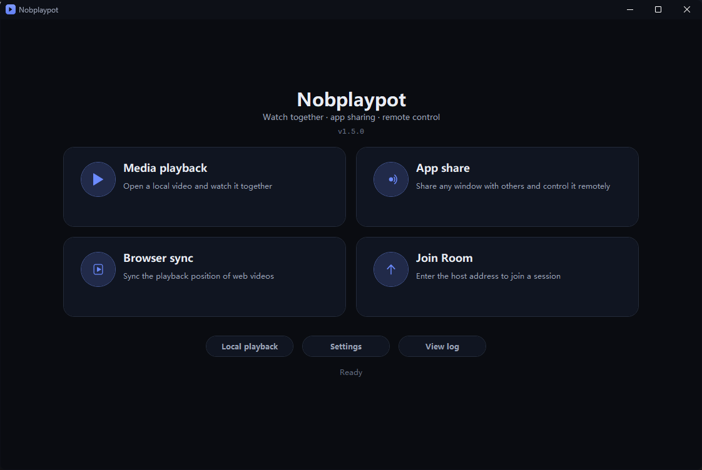
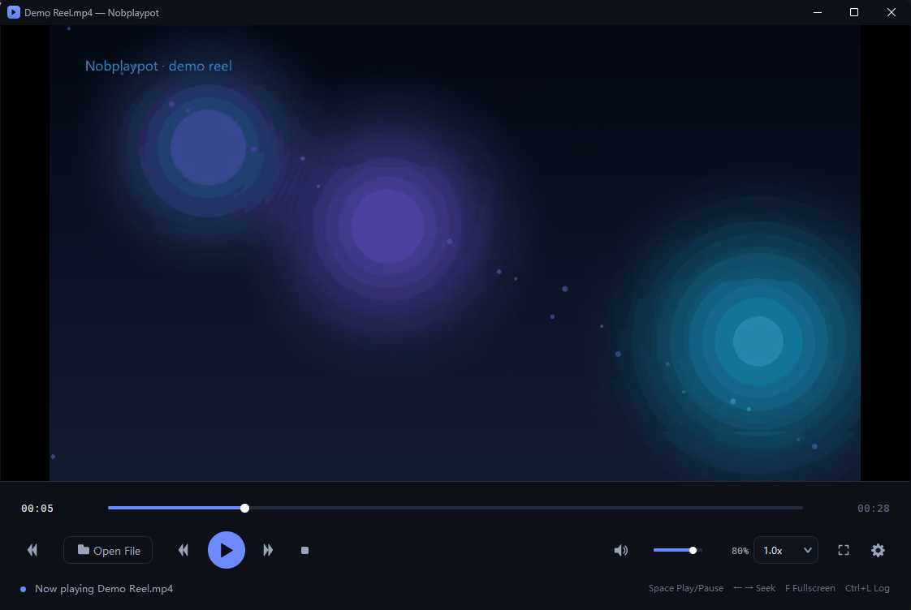
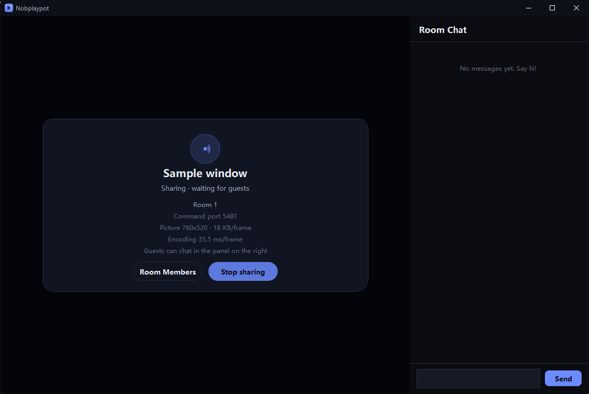
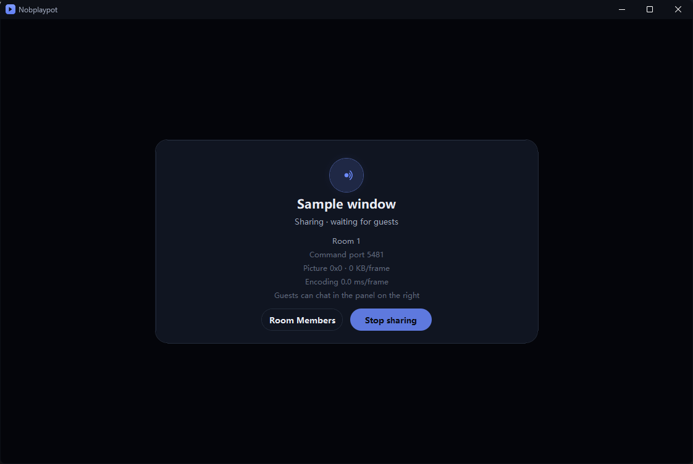
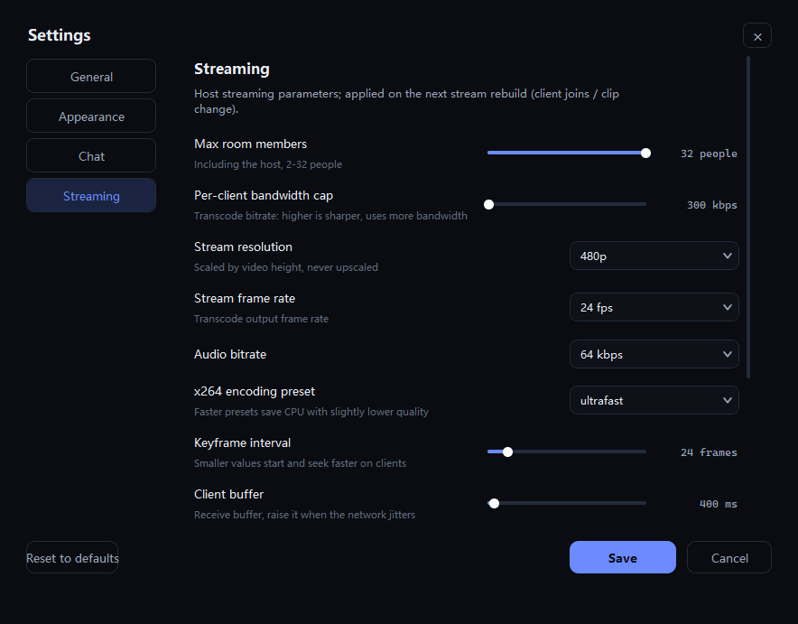

**English** | [中文](README.zh-CN.md)

🌐 **Website**: https://nobri6039.github.io/Nobplaypot/


# Nobplaypot

**Share audio, video and control** on your LAN: watch together, and drive a computer together.

Three ways to share, one room:

- **Media playback** — the host plays a local video, guests watch in sync, and can control seek / speed / volume
- **App sharing** — stream any window (browser, player, app) to guests, who can also drive the mouse and keyboard
- **Browser sync** — everyone opens the page, playback positions stay aligned

Everything is custom-drawn (no default light ttk widgets): antialiased rounded corners, a dark title bar, a floating fullscreen dock, and a bilingual UI.



## Screenshots

**Main menu** — pick what to do instead of landing in a player


**Media playback** — seek, speed, volume, audio tracks / subtitles, fullscreen



**Shared session** — the host's app-sharing screen (status card + room chat + members/stop)



**Browser sync** — syncs the page URL and playback position only



**Settings** — 7 tabs; each sharing mode has its own parameters



## What's new in v1.5.0

- **Background capture**: app sharing now uses `PrintWindow` by default, so a window that is fully covered or unfocused still streams its complete picture; if the window refuses (games, some self-drawn apps) it falls back to the screen grab automatically. Both the share dialog toggle and the "Capture mode" setting can switch back. Minimised windows stay impossible to capture — Windows stops compositing them.
- **Zoom is now purely client-side**: the host always sends the original 100% picture; each guest scales its own window through the linear 25/50/75/100/125/150/175/200% steps without affecting anyone else, auto-picks a smaller step when its screen cannot fit, and the sharing window can no longer be dragged into a stretched shape.
- **Much lower latency** (measured 45–55 ms → **25–28 ms**): fixed the client using HALFTONE interpolation for a 1-pixel size mismatch (15–24 ms per frame) — blitting is now 0.7 ms; the host blits 1:1 instead of stretching and computes the static-frame fingerprint from the already captured bitmap; the client decodes only the newest frame.
- **Browser-sync start page ships with the app**: the template lives in `Bin\browser_start.html` and is rendered to `C:\Temp\nobplaypot_start.html`, so host and guest share the same absolute `file://` path and a synced URL opens on both sides.
- **Per-stage latency logging**: `[lat] frames.recv … wire=… decode=… blit=…` shows whether capture, network or blit is the bottleneck.
- **Fixes**: the quality dropdown in the share dialog was never packed (a lonely "画质" label was all that showed), zoom above 100% did nothing, the percentage label stuck at 100%, and the English UI missed the quality preset labels.

Full details: [v1.5.0 release notes](docs/release-notes/RELEASE_NOTES_v1.5.0.md).

## Features

### Main menu

- Four cards: Media playback / App sharing / Browser sync / Join room
- Bottom row: local playback, settings, view log
- Going back to the menu ends the current session, so no stale rooms are left behind

### Media playback

- Drag & drop a video, or open one through the custom dark file dialog
- Play/pause, seek, volume/mute, 0.25x–4.0x speed
- Audio track / subtitle switching, fullscreen, danmaku, room chat
- Hosting jumps straight into the player and asks for a clip

### App sharing

- Pick a window; its picture and input are mirrored live
- **Frame stream**: JPEG + UDP fragments, 30fps by default (up to 60); unchanged frames skip encoding
- **Zoom 25%–200%**: re-captures at scale, window and hit area scale with it, 1:1 without cropping
- **Input**: mouse buttons, wheel, drag, keyboard, and an IME/paste text channel
- **Permission**: read-only by default; the host grants control per member in Room Members, effective immediately
- **Background capture**: PrintWindow by default, so a covered or unfocused window still streams its full picture; the legacy screen grab stays available (share dialog / Capture mode setting). Minimised windows are not composed by Windows and cannot be captured
- Closing the shared window ends the room and guests leave automatically

### Browser sync

- Built-in Edge driven over CDP; each side renders locally, only URL and progress are synced
- In-page actions (seek, speed, pause) are detected and reported to the host
- Poll interval, allowed drift and start URL are configurable

### Rooms

- Room password, member list, kick, per-member control grants, room chat
- Configurable heartbeat and offline detection; 2–32 people

### Settings

7 tabs: **General / Appearance / Chat / Streaming (shared) / Media playback / Browser sync / App sharing**.
Streaming only holds what every mode shares (member limit, heartbeat, offline detection, default ports); each mode keeps its own parameters on its own tab.

### Logs

- Per-role files: `%APPDATA%\Nobplaypot\logs\nobplaypot-host.log` and `nobplaypot-client.log`
- Millisecond timestamps; `[lat]` records per-stage timings, `[appinput]` records capture → send → receive → inject

## Quick start

1. Download and extract `Nobplaypot.zip` (keep the layout: `Nobplaypot.exe` + `Bin\` + `python-runtime\` + `vlc-runtime\`)
2. Run `Nobplaypot.exe`
3. Pick a mode on the main menu:
   - **Media playback** → set ports/password, host, choose a video → guests use **Join room**
   - **App sharing** → set ports/password, choose the window to share
   - **Browser sync** → set ports/password, play a video in the opened browser
4. Guests enter the host address in **Join room** (default TCP 5000 / UDP 5001)

## Requirements

- Windows 10 / 11 (x64)
- No Python or VLC installation needed — portable runtimes ship with the app
- Browser sync needs Microsoft Edge (preinstalled on Windows 10/11)
- LAN: the host must allow the TCP command port and the UDP media port

## Build & release

The launcher is C++ (VS2019); the payload is the Python modules under `Bin\` plus the portable runtimes, and the launcher verifies a signature and per-file hashes at startup.

```powershell
# One command: sync modules to Bin -> sign manifest -> build launcher -> copy exe to the repo root
powershell -ExecutionPolicy Bypass -File tools\release-1.5.0.ps1

# Refresh screenshots only
powershell -ExecutionPolicy Bypass -File tools\update-screenshots.ps1
```

- `tools\sign.ps1` writes `Bin\payload.manifest` and `payload.sig`
- `tools\make_start_page.py` generates `Bin\browser_start.html` (the browser-sync start page template; the release script runs it for you)
- At runtime a rendered copy goes to `C:\Temp\nobplaypot_start.html`: a browser `file://` URL is absolute, and host and guest live in different folders, so the path has to be identical on both machines
- Public key lives in `launch\pubkey.h`; the private key is `launch\tools\private-key.xml` (**never ship it**)
- Any change to `Bin`, `python-runtime` or `vlc-runtime` requires re-signing, otherwise the launcher refuses to start

## Layout

```
Nobplaypot.exe           launcher (verifies the payload, then starts pythonw)
Bin\                     entry point and modules (Nobplaypot.pyw + np_*.py)
python-runtime\          portable Python
vlc-runtime\             portable VLC
launch\                  launcher C++ sources and public key
docs\                    website and release notes
tools\                   signing / release / screenshot scripts
screenshots\             README screenshots (zh / en)
```

## Known limitations

- App-sharing control relies on window messages: WeChat, most games and some Electron/self-drawn apps ignore synthetic messages and stay view-only
  (driving them needs `sendinput`, which moves the host cursor)
- Chinese text goes through the bottom text box; the keyboard path cannot capture IME composition
- Browser sync depends on the site: some sites reject `playbackRate` changes or `currentTime` seeks

## License

See [LICENSE](LICENSE). Made by **Nobri with deepseek**.
