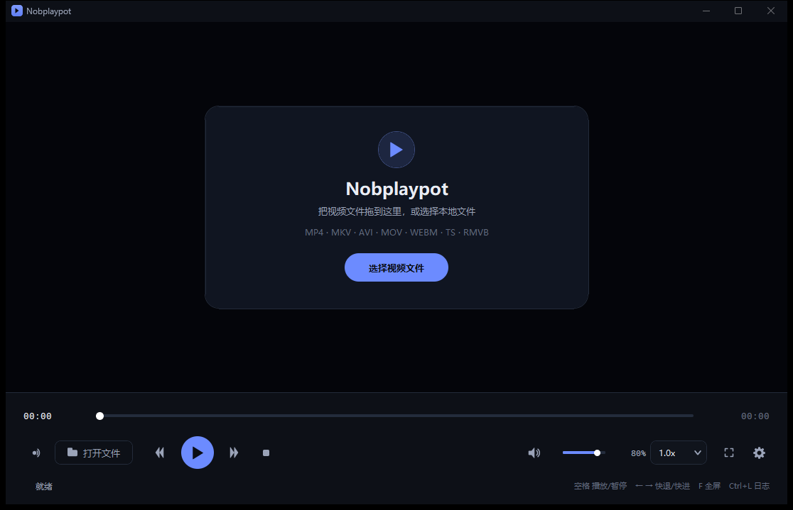
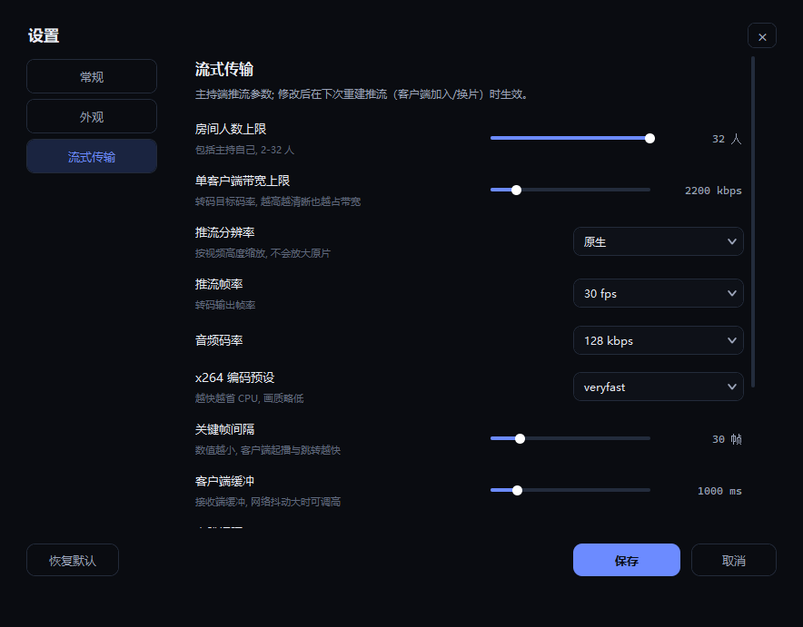
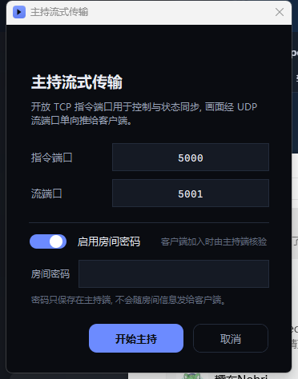
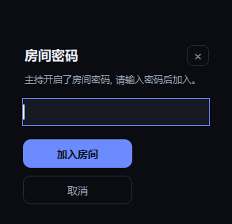
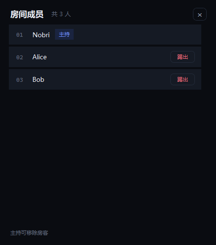
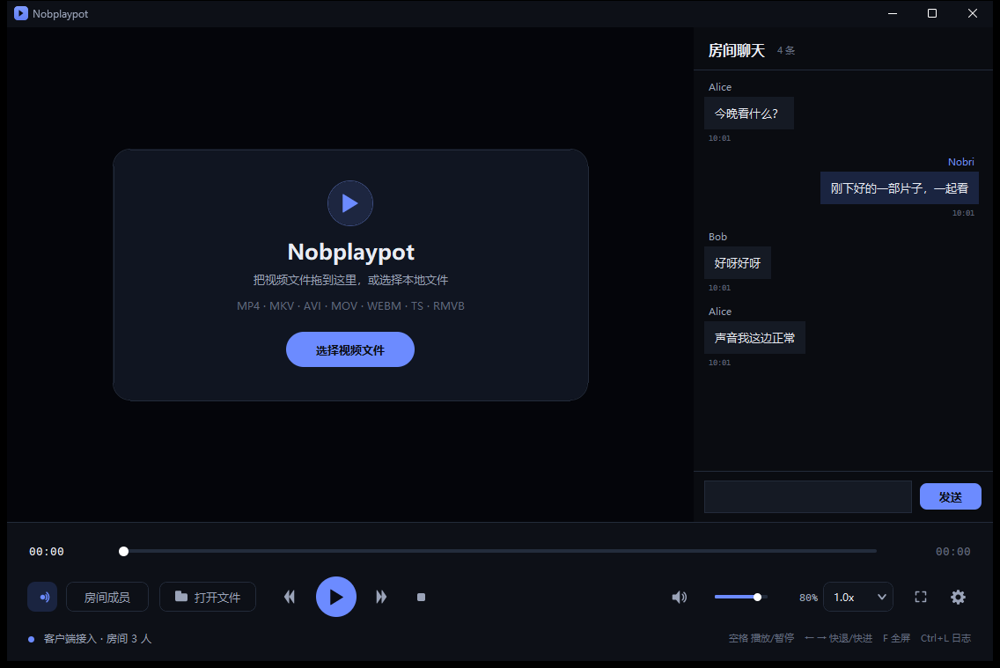
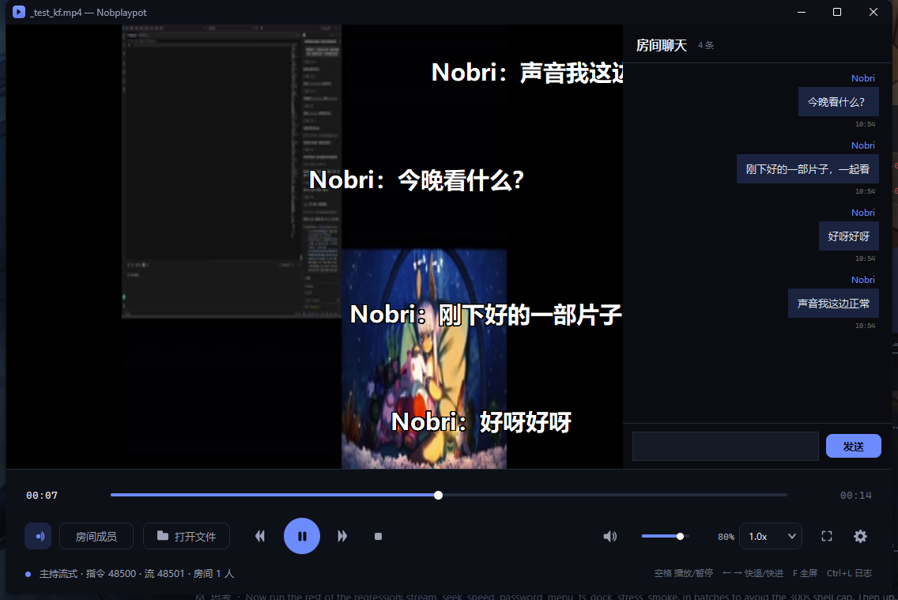
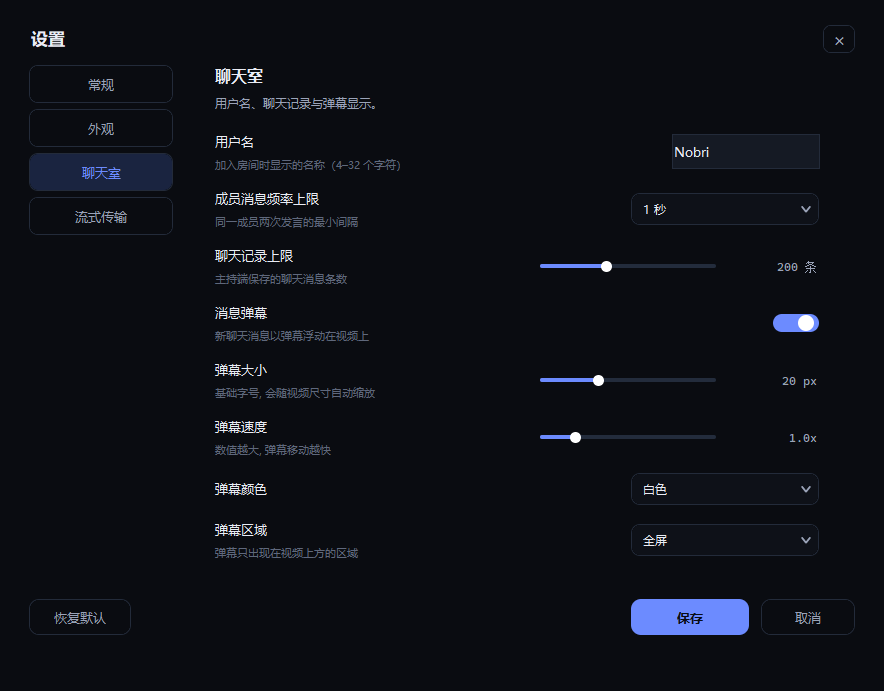
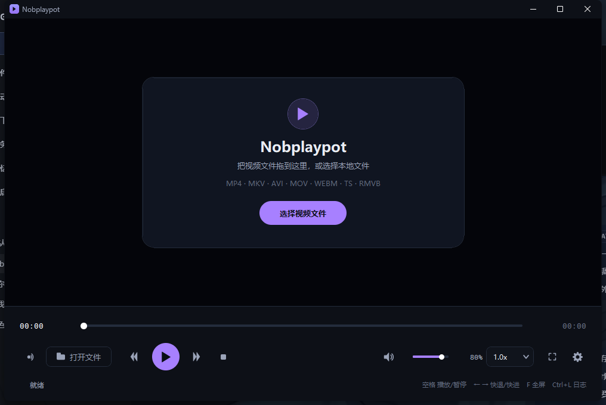

[English](README.md) | **中文**

# Nobplaypot

一个用 **VLC（libvlc）+ Tkinter** 编写的深色视频播放器，支持局域网多人同步观看：主持推流、客户端加入、房间密码，以及遥控播放 / 暂停 / 拖进度 / 改速度。

> A dark-themed, VLC-powered video player with LAN co-watching: host/join, room password, and remote play / seek / speed control.

界面完全自绘（不使用 ttk 默认浅色控件），带抗锯齿圆角与图标、深色标题栏，以及全屏时从底部浮出的控制岛。



## 截图

**全屏悬浮控制岛**


**设置 · 流式传输**



**房间密码**

<p>


</p>

**房间成员**



**房间聊天**



**弹幕**



**聊天室设置**



**主题：紫罗兰**



## 功能特性

### 播放
- 拖放视频文件，或通过自绘的深色文件选择框打开
- 播放 / 暂停、进度拖动、音量 / 静音、0.25x–4.0x 倍速
- 全屏播放，方向键快退 / 快进，自动隐藏控制栏
- 支持 MP4 / MKV / AVI / MOV / WMV / FLV / WEBM / TS / RMVB 等常见格式

### 界面
- 全部 Canvas 自绘：按钮、滑杆、下拉框、文件列表、提示框、空状态卡片
- 抗锯齿图标与圆角，播放键为解析式抗锯齿圆
- 5 套强调色（极光蓝 / 紫罗兰 / 青碧 / 玫瑰 / 琥珀）× 3 种界面底色（深蓝黑 / 纯黑 / 岩灰）
- 悬停渐变动画，可在设置中关闭

### 全屏控制岛
- 鼠标移动到屏幕底部区域时，从底部浮出一块与屏幕边缘**不接触**的圆角悬浮控制条
- 播放 / 暂停、后退 / 快进、进度条、音量、倍速、退出全屏
- 鼠标离开 1.6 秒后自动滑下隐藏

### 流式传输（局域网）
- **主持**：开放一个 TCP 指令端口（默认 5000）和一个 UDP 流端口（默认 5001），把画面转码成 H.264/TS 后推给客户端
- **加入**：填写主持的指令地址和本机接收流地址，用本机 VLC 直接渲染主持推来的 UDP 画面
- 状态同步：文件、进度、总时长、暂停、倍速；客户端遥控播放 / 暂停 / 拖动 / 倍速，音量与静音属于本机
- 房间人数、成员列表实时同步，最多 32 人（可调）

### 房间密码
- 主持开始主持时可选择是否启用密码（默认启用），密码只保存在主持端
- 客户端加入时若房间有密码，会弹出密码框，密码**提交给主持端核验**，核验通过才真正加入
- 常量时间比较、单连接最多 5 次尝试，密码不会随房间信息下发给其他客户端

### 房间成员
- 每个端（主持或房客）都可以在 **设置 → 聊天室** 里设置显示用户名，默认取计算机名（4–32 个字符）
- 加入房间后，主界面会多出一个 **房间成员** 按钮
- 列表按主持在最上面、房客按加入顺序排列，可滚动（最多 32 人）；主持可以点 **踢出** 移除房客

### 房间聊天
- 加入房间后，主窗口右侧会出现聊天面板（类似微信的消息列表 + 输入框）
- 所有消息由主持端存储；房客通过指令端口发送，主持转发给所有人（包括发送者）之后才在本地显示
- 新房客加入时会收到完整历史消息；主持端默认保留最近 200 条（可在 **设置 → 聊天室** 修改）
- 主持端可限制同一成员两次发言的最小间隔（无限制 / 1 / 2 / 3 / 5 秒）；被驳回时客户端输入框内显示灰色“发送频率过快”水印

### 弹幕
- 新聊天消息以弹幕形式从右向左飘过视频上方，窗口模式和全屏模式都支持
- 每条弹幕随机选择赛道；弹幕多时排队并整体智能加速，避免同一赛道重叠
- 弹幕大小随视频尺寸自动缩放，避免窗口和全屏大小不一致；只要播放窗口/视频在屏幕上可见就显示（不要求窗口在前台），被其他窗口完全盖住或最小化时自动隐藏；总开关、大小、速度、颜色、区域在 **设置 → 聊天室** 调整

### 推流中拖动进度 / 改速度
- 客户端拖动只把指令发给主持，不在本地处理
- 主持端收到跳转或速度变化后：**中断当前推流 → 用 `:start-time` / `:rate` 从新进度、新速度重建推流 → 广播 `resync` → 客户端重连画面**
- 推流时间轴从 0 重新开始，客户端会在约一秒内恢复画面

## 环境要求

- **Windows 10 / 11（64 位）**：深色标题栏、窗口圆角等使用 Win32 API
- **Python 3.10+**（开发与测试环境为 Python 3.15，Tk 9.0）
- **VLC 3.x 桌面版（64 位）**：需要 `libvlc.dll`（便携版已内置）
- Python 依赖：

```bash
pip install python-vlc tkinterdnd2
```

> 如果程序提示找不到 VLC，请先安装 64 位 VLC；也可以设置环境变量 `VLC_HOME` 指向 VLC 安装目录（含 `libvlc.dll`）。

## 安装与运行

```bash
git clone https://github.com/Nobri6039/Nobplaypot

cd Nobplaypot

pip install python-vlc tkinterdnd2

python Nobplaypot.py
```

也可以直接双击 **`Nobplaypot.pyw`** 启动，不会弹出控制台窗口。

### 免安装便携版

便携包在 `python-runtime/` 目录里带了一套**最小的 Python 3.15 运行时**（含 Tkinter、`python-vlc`、`tkinterdnd2`），约 34 MB，不是完整的 Python 安装；另外在 `vlc-runtime/` 内置了一套**最小的 VLC 3.0.24 运行库**（约 53 MB）。双击 **`启动 Nobplaypot.bat`** 即可运行，或执行：

```bat
python-runtime\pythonw.exe Nobplaypot.pyw
```

便携版无需安装 Python 或 VLC。内置的 VLC 运行库遵循 GPLv2+，许可证见 `vlc-runtime/COPYING.txt`，源码见 videolan.org。

## 使用说明

### 播放
| 快捷键 | 功能 |
| --- | --- |
| `空格` | 播放 / 暂停 |
| `←` / `→` | 快退 / 快进（步长可在设置里改，默认 5 秒） |
| `↑` / `↓` | 音量 +5 / -5 |
| `F` | 进入 / 退出全屏 |
| `Esc` | 退出全屏 |
| `Ctrl+O` | 打开文件 |
| `Ctrl+L` | 打开日志目录 |

### 主持一次流式会话
1. 先打开要观看的视频；
2. 点左下角的流式按钮 → **主持流式传输**；
3. 填写指令端口和流端口（默认 5000 / 5001）；
4. 「启用房间密码」默认开启，输入密码（或关掉开关使用无密码房间）；
5. 点「开始主持」。

### 加入会话
1. 点流式按钮 → **加入流式传输**；
2. 指令地址填主持的 IP:端口（如 `192.168.1.10:5000`）；
3. 流接收地址填**本机**接收 UDP 的地址（如 `192.168.1.20:5001`）；
4. 如果房间有密码，会弹出密码框，输入正确密码后加入。

> 局域网使用最省事。公网使用需要在主持端路由器上把 TCP 指令端口和 UDP 流端口映射出去，并放行防火墙；跨公网时 UDP 丢包也会影响观看体验。

### 设置
主界面右下角的齿轮按钮打开设置，分四页：

- **常规**：解码方式（自动 / 硬件 / 软件，重启生效）、默认音量、快进步长、打开后自动播放、记住上次目录、日志级别
- **外观**：强调色、界面底色、悬停动画（颜色与底色重启后生效）
- **聊天室**：用户名、成员消息频率上限、聊天记录上限、消息弹幕、弹幕大小、弹幕速度、弹幕颜色、弹幕区域
- **流式传输**：房间人数上限、单客户端带宽、推流分辨率（480p / 720p / 1080p / 原生）、推流帧率、音频码率、x264 预设、关键帧间隔、客户端缓冲、心跳间隔、离线判定、默认端口

设置保存在 `%APPDATA%\Nobplaypot\config.json`。流式参数在下次重建推流（客户端加入 / 拖进度 / 改速度）时生效。

## 数据与日志

| 内容 | 位置 |
| --- | --- |
| 配置 | `%APPDATA%\Nobplaypot\config.json` |
| 日志 | `%APPDATA%\Nobplaypot\logs\nobplaypot.log`（2 MB 轮转，保留 3 份） |

日志相关环境变量：

- `NOBPLAYPOT_LOG_LEVEL=DEBUG`：输出调试日志
- `NOBPLAYPOT_LOG_FILE=<路径>`：把日志写到指定文件

## 实现说明

- **指令通道**：TCP + 换行分隔的 JSON，心跳 2 秒，8 秒无消息判定离线
- **流通道**：UDP（TS 封装），主持端用 libvlc 的 `sout` 转码成 H.264 + AAC
- **跳转 / 变速**：libvlc 的 sout 链原地 `seek` 会永久断流，因此采用「中断推流 → 按新进度 / 新速度重建 → 广播 `resync` → 客户端重连」的方式
- **密码**：主持端在客户端注册前核验（`hmac.compare_digest`），未通过不进房间、不计人数、不推流
- **稳定性**：libvlc 停止 UDP 输入 / 释放播放器偶尔会阻塞，相关回收都放在后台线程，界面线程不做可能阻塞的 VLC 调用；并带 UI 看门狗记录卡顿

## 已知限制

- 推流中拖动进度或修改速度时，客户端会短暂重连一次画面（推流链必须重建）
- 转码会占用 CPU，可降低分辨率 / 码率 / 帧率；速度与推流同时使用时对 CPU 要求更高
- 一个主持端对应一个房间；主要面向局域网使用
- 暂不支持播放列表、字幕、画面比例切换等进阶播放功能

## 项目结构

```text
Nobplaypot/
├── Nobplaypot.py      # 主程序（单文件）
├── Nobplaypot.pyw     # 无控制台启动入口
├── screenshots/       # README 截图
├── README.md          # 英文说明（默认）
├── README.zh-CN.md    # 中文说明
├── .gitignore
└── LICENSE
```

## 项目后续发展

1. UUID 标识
2. 拓展更多系统平台
3. 更流畅的同步体验以及更多功能扩展实现

## 致谢

- [VLC media player](https://www.videolan.org/) / libvlc
- [python-vlc](https://github.com/oaubert/python-vlc)
- [tkinterdnd2](https://github.com/Eliav2/tkinterdnd2)

## 作者与版权

- **创作：DeepSeek V4.1 Flash（AI 助手）**——本项目的代码、文档与截图均由 AI 完成。
- **发布与维护：Nobri6039。**
- 版权：Copyright © 2026 Nobri6039；本项目基于 [MIT License](LICENSE) 发布。
- 转载或分发请注明“由 DeepSeek V4.1 Flash 创作”，并保留本说明。

> 内置的 VLC 运行库遵循其自身的 GPLv2+ 许可证。

## License

[MIT](LICENSE)
