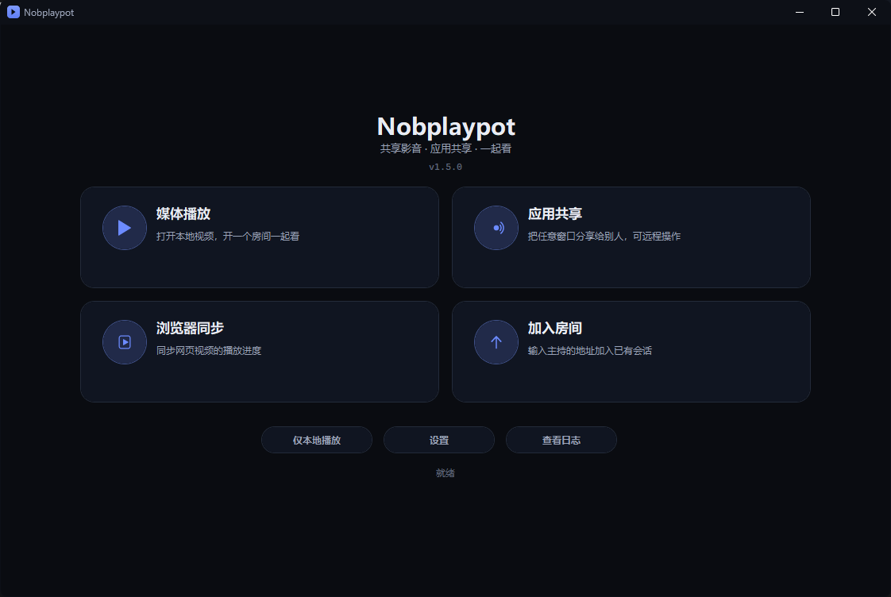
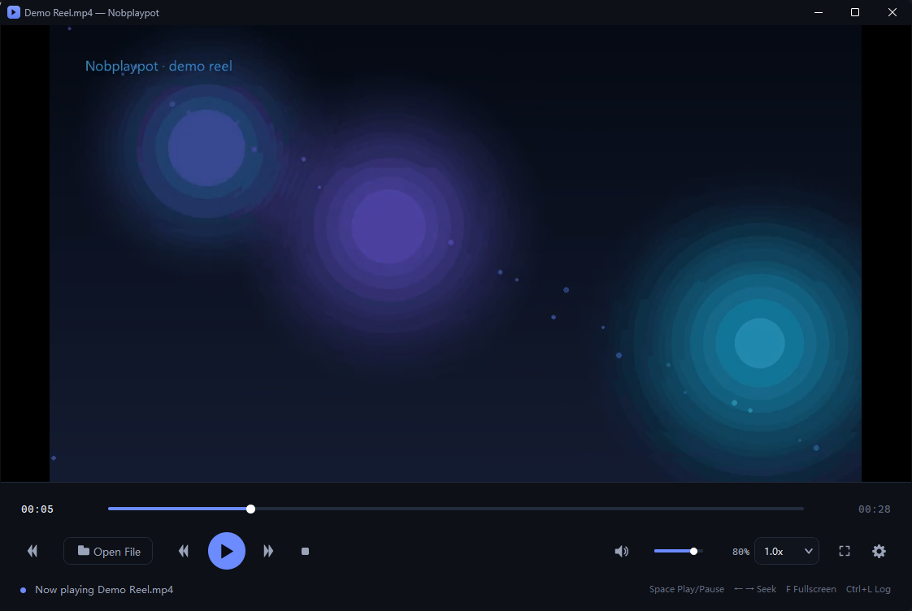
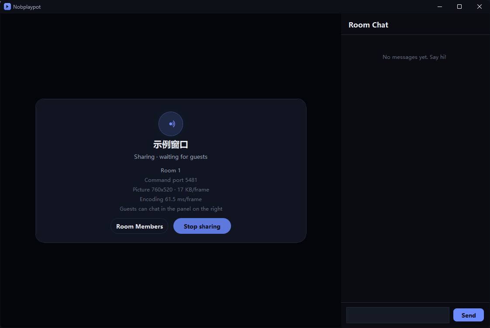
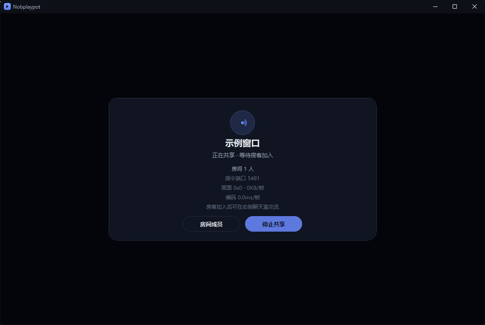
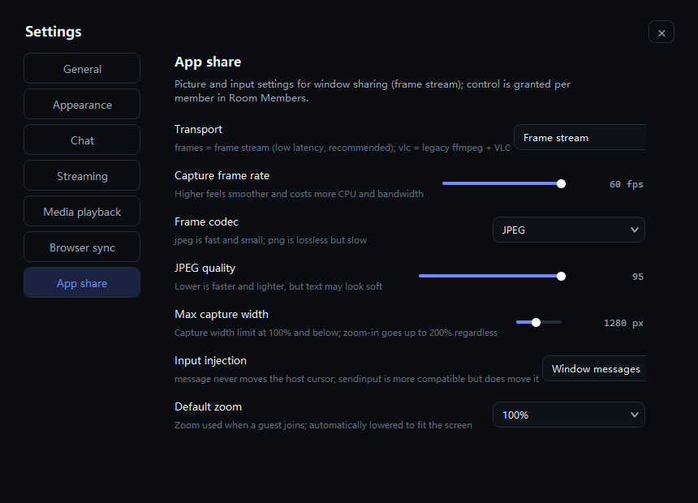

[English](README.md) | **中文**

🌐 **官网**: https://nobri6039.github.io/Nobplaypot/


# Nobplaypot

**局域网多人协同工具**：一起看视频，一起操作同一个软件，一起同步网页。

三种协同方式，一个房间搞定：

- **媒体播放** —— 主持放本地视频，房客同步观看，进度/倍速/音量可遥控
- **应用共享** —— 把任意窗口（浏览器、播放器、软件）连画面带操作推给房客，对方能直接用鼠标键盘动手操作，权限按人授权
- **浏览器同步** —— 各自打开网页，播放进度自动对齐

界面全部自绘（不使用 ttk 默认浅色控件）：抗锯齿圆角、深色标题栏、全屏浮动控制岛，以及中英双语。



## 截图

**主菜单**：启动后先选要做什么，不再一打开就是播放器


**媒体播放**：进度 / 倍速 / 音量 / 音轨字幕 / 全屏



**共享会话**：应用共享的主持界面（状态卡 + 房间聊天 + 成员/停止）



**浏览器同步**：只同步网页地址与播放进度



**设置**：7 个分页，三种共享方式各有独立参数



## v1.5.0 新增

- **后台捕获**：应用共享默认改用 `PrintWindow`，窗口被别的窗口完全盖住、或者没有焦点也能抓到完整画面；抓不到（游戏/部分自绘程序）会自动退回屏幕采集。设置里的「捕获方式」和共享对话框的「后台捕获」开关都能切回旧方式。最小化仍然抓不到（Windows 不合成最小化窗口）。
- **缩放彻底改成房客本机**：主持端永远只传原画 100%，房客按 25/50/75/100/125/150/175/200% 线性档位缩放自己的窗口，多人同时看互不影响；加入时按自己屏幕自动降档；共享窗口禁止手动拉伸。
- **延迟大幅下降**（实测 45~55ms → **25~28ms**）：修掉客户端在差 1 像素时误用 HALFTONE 插值（15~24ms/帧）的问题，贴图降到 0.7ms；主持端 1:1 抓屏改 BitBlt、静止判定不再二次读屏；客户端只解码最新一帧。
- **浏览器同步起始页随程序走**：模板在 `Bin\browser_start.html`，运行时渲染到 `C:\Temp\nobplaypot_start.html`，主持与房客的绝对路径一致，同步过去的网址两边都打得开。
- **分阶段延迟日志**：`[lat] frames.recv … wire=… decode=… blit=…`，一眼看出瓶颈在抓取、网络还是贴图。
- **修复**：共享对话框「画质」下拉框没显示（只剩一个孤零零的「画质」）、放大到 100% 以上窗口不动、百分比标签卡在 100%、英文界面画质档位没翻译。

完整说明见 [v1.5.0 发布说明](docs/release-notes/RELEASE_NOTES_v1.5.0.md)。

## 功能特性

### 主菜单

- 四张卡片：媒体播放 / 应用共享 / 浏览器同步 / 加入房间
- 底部：仅本地播放、设置、查看日志
- 会话进行中回主菜单会自动结束会话，不会留下“僵尸房间”

### 媒体播放

- 拖放视频文件，或通过自绘深色文件对话框打开
- 播放/暂停、进度拖动、音量/静音、0.25x–4.0x 倍速
- 音轨 / 字幕切换、全屏、弹幕、房间聊天
- 主持开房后自动进入播放器并提示选片

### 应用共享

- 选一个窗口共享，画面与操作实时同步
- **帧直传**：JPEG 编码 + UDP 分片，30fps 起、可调到 60fps；静止画面跳过编码
- **缩放 25%–200%**：按比例重抓，窗口与触控区域一起缩放，1:1 不裁剪
- **输入**：鼠标左右中键、滚轮、拖动、键盘，以及输入法/粘贴文本通道
- **权限**：默认只读；主持在「房间成员」里给某个成员单独开控制权，立即生效
- **后台捕获**：默认走 PrintWindow，窗口被别的窗口盖住、或者没有焦点也能抓到完整画面；老版屏幕截图保留为可选（共享对话框 / 设置里的「捕获方式」）。最小化时 Windows 不再合成，任何方式都抓不到
- 共享窗口被关闭时房间自动结束，房客自动退出

### 浏览器同步

- 内置 Edge（CDP 驱动），主持/房客各自渲染，只同步地址与播放进度
- 支持网页内反向操作（拖动、倍速、暂停）并回报主持
- 同步轮询间隔、允许偏差、起始网址可在设置里调

### 房间

- 房间密码、成员列表、踢人、逐人控制授权、房间聊天
- 心跳与离线判定可调；人数上限 2–32

### 设置

7 个分页：**常规 / 外观 / 聊天室 / 流式传输（共用）/ 媒体播放 / 浏览器同步 / 应用共享**。
流式传输只放所有方式共用的东西（人数上限、心跳、离线判定、默认端口），媒体与共享各自的参数在对应分页。

### 日志

- 按角色分文件：`%APPDATA%\Nobplaypot\logs\nobplaypot-host.log` / `nobplaypot-client.log`
- 每行毫秒时间戳；`[lat]` 记录各阶段耗时，`[appinput]` 记录 捕获→发送→收到→注入 四段

## 快速开始

1. 下载 `Nobplaypot.zip` 并解压（保持目录结构：`Nobplaypot.exe` + `Bin\` + `python-runtime\` + `vlc-runtime\`）
2. 双击 `Nobplaypot.exe`
3. 主菜单选择模式：
   - **媒体播放** → 配置端口/密码开房 → 选视频 → 房客「加入房间」
   - **应用共享** → 配置端口/密码 → 选要共享的窗口
   - **浏览器同步** → 配置端口/密码 → 在打开的浏览器里放视频
4. 房客在「加入房间」里填主持的地址（默认 TCP 5000 / UDP 5001）

## 系统要求

- Windows 10 / 11（x64）
- 无需安装 Python / VLC：便携运行时已随包提供
- 浏览器同步需要系统安装 Microsoft Edge（Win10/11 自带）
- 局域网：主持端需放行 TCP 指令端口与 UDP 媒体端口

## 构建与发布

启动器是 C++（VS2019），载荷是 `Bin\` 下的 Python 模块 + 便携运行时，启动时校验签名与哈希。

```powershell
# 一条命令：同步模块到 Bin → 生成清单与签名 → 编译启动器 → 复制 exe 到根目录
powershell -ExecutionPolicy Bypass -File tools\release-1.5.0.ps1

# 只更新截图
powershell -ExecutionPolicy Bypass -File tools\update-screenshots.ps1
```

- `tools\sign.ps1` 生成 `Bin\payload.manifest` + `payload.sig`
- `tools\make_start_page.py` 生成 `Bin\browser_start.html`（浏览器同步的起始页模板，发布脚本会自动跑）
- 起始页运行时会渲染一份到 `C:\Temp\nobplaypot_start.html`：浏览器的 `file://` 是绝对路径，主持与房客安装目录不同，必须固定成同一个路径才能互相打开
- 公钥在 `launch\pubkey.h`，私钥在 `launch\tools\private-key.xml`（**不要外发**）
- 改了 `Bin` / `python-runtime` / `vlc-runtime` 任何文件都必须重新签名，否则启动器拒绝启动

## 目录结构

```
Nobplaypot.exe           启动器（校验签名后拉起 pythonw）
Bin\                     程序入口与业务模块（Nobplaypot.pyw + np_*.py）
python-runtime\          便携 Python
vlc-runtime\             便携 VLC
launch\                  启动器 C++ 源码与公钥
docs\                    官网页面与发布说明
tools\                   签名 / 发布 / 截图脚本
screenshots\             README 截图（zh / en）
```

## 已知限制

- 应用共享的控制依赖窗口消息：微信、多数游戏、部分 Electron/自绘程序不处理合成消息，只能观看
  （要操控这类程序只能改用 `sendinput`，会移动主持端光标）
- 中文输入走底部输入框的文本通道；直接抓键盘按键拿不到输入法组字结果
- 浏览器同步受站点限制：部分站点禁止修改 `playbackRate` 或拦截 `currentTime` 跳转

## 许可

见 [LICENSE](LICENSE)。作者：**Nobri with deepseek**
